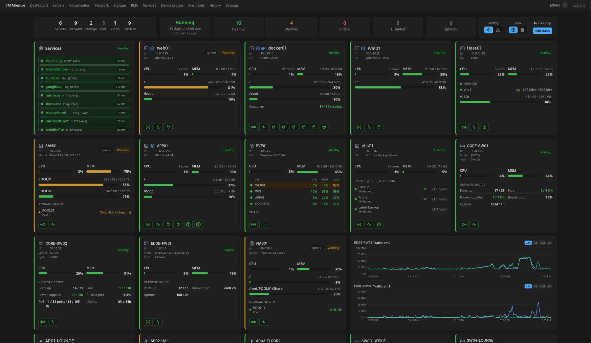
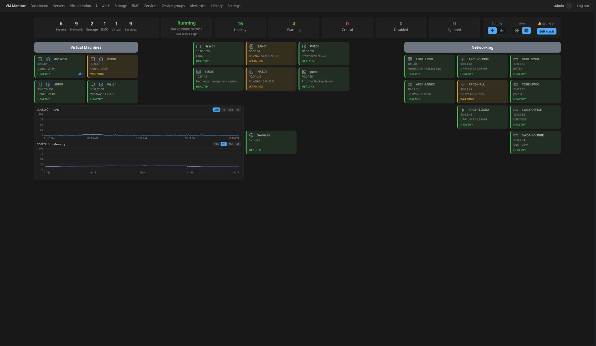
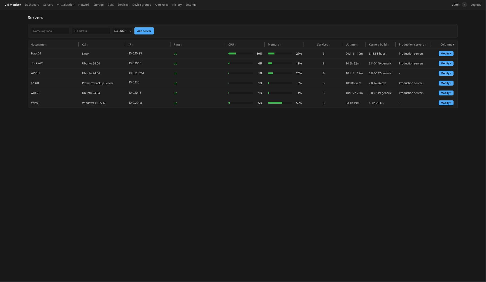
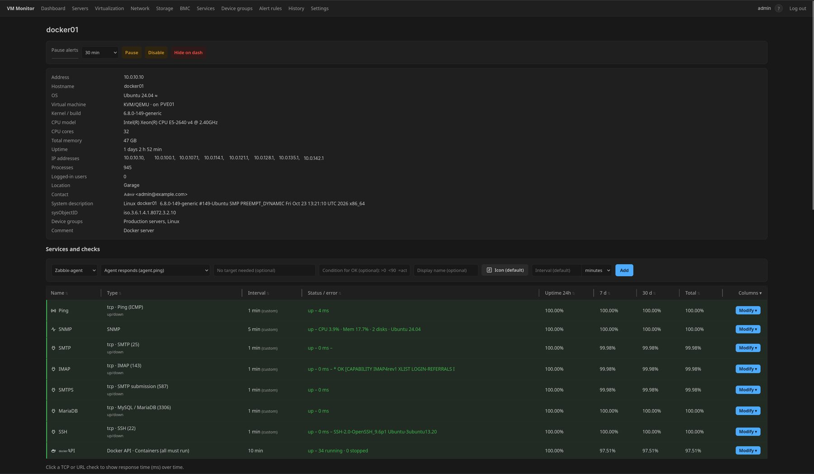
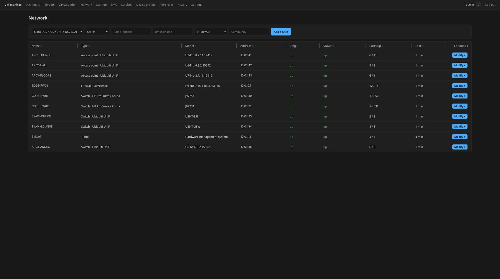
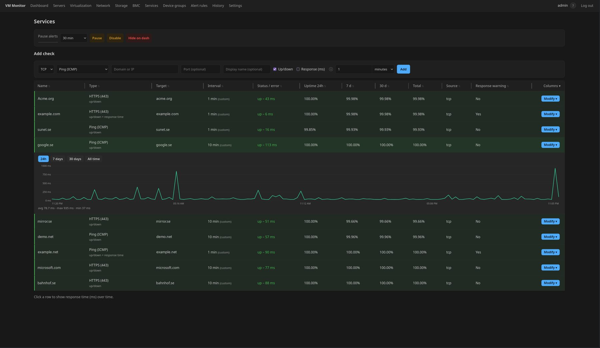
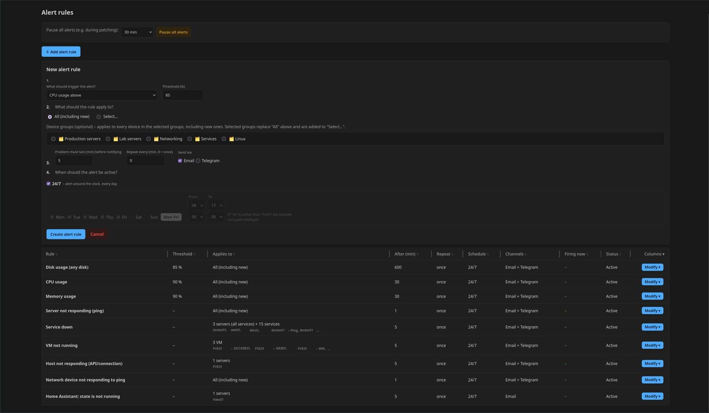
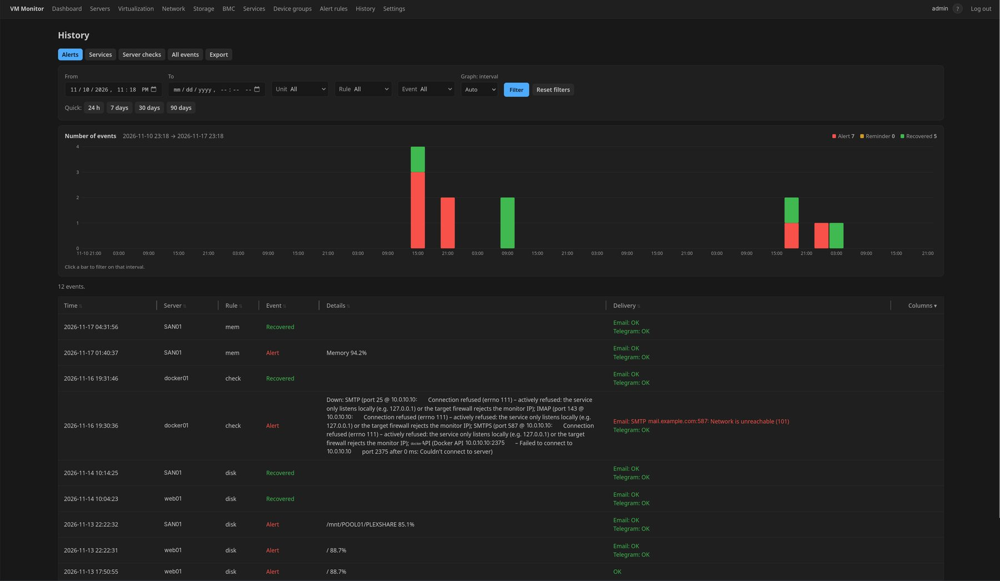

# VM Monitor (vmmon)

**Official website and documentation: <https://vm-monitor.com>**

A powerful, modern and simpler alternative to LibreNMS. VM Monitor is a self-hosted monitoring system written in PHP 8 and MariaDB/MySQL.

Monitor servers, virtualisation hosts, network devices, storage and BMC/IPMI through SNMP, SNMP traps, syslog, the Zabbix agent
(active and passive), and TCP, URL and certificate checks. Readable alert rules send notifications by e-mail, SMS, Telegram, Signal and webhook.

## Screenshots

| | |
|---|---|
|  |  |
|  |  |
|  |  |
|  |  |

More screenshots and the full documentation: <https://vm-monitor.com>

## Quick install (Debian 11/12/13, Ubuntu 22.04/24.04)

```bash
curl -fsSL https://raw.githubusercontent.com/pellle87/vmmon/main/install-vmmon.sh -o install-vmmon.sh
sudo VMMON_ZIP=https://github.com/pellle87/vmmon/releases/latest/download/vmmon.zip bash install-vmmon.sh
```

The script asks for domain, web server (Apache/Nginx), database and TLS, then installs PHP, MariaDB, the web server,
the `vmmon-worker` service (and optionally `vmmon-zabbix` and `vmmon-recv` for traps/syslog), creates the database
and `config.local.php`, and sets sensible kernel/database tuning. Run `sudo bash install-vmmon.sh --help` for the
unattended mode (`--yes` plus environment variables).

Open the site, create the administrator account and fill in **Settings** (SMTP, intervals, notifications).

## Manual install

Requirements: PHP 8+ with `curl`, `openssl`, `pdo_mysql`, `snmp`, `zip`, `zlib`; MariaDB/MySQL; a web server over HTTPS.

1. Download `vmmon.zip` from the [latest release](https://github.com/pellle87/vmmon/releases/latest) and unpack it into the web root.
2. Create a database and user, then `mysql -u root -p < vmmon/sql/schema.sql`.
3. Copy `config.local.php.example` to `config.local.php` and enter the database details.
4. Install the services `vmmon-worker.service` (and `vmmon-zabbix.service`, `vmmon-recv.service` if you use them) from the `vmmon` folder.

Full documentation (install, dashboard, checks, alert rules, SNMP/MIBs, traps and syslog): <https://vm-monitor.com>.

## Updating

- **In the app:** *Update* page → enter `pellle87/vmmon` → **Check GitHub for an update**. The latest release is downloaded and shown for
  confirmation; nothing is replaced until you press install. A backup of files and database is taken first, the SQL migration is run
  and your `config.local.php` and downloaded icons are left alone.
- **By hand:** download `Vmmon_<version>.zip` from [Releases](https://github.com/pellle87/vmmon/releases) and upload it on the same page.

After an update, restart the background services once so they load the new code:
`sudo systemctl restart vmmon-worker vmmon-zabbix vmmon-recv`

The server needs outbound HTTPS to `api.github.com` and `github.com` for the in-app check.


## License

VM Monitor is free to use, for private and commercial use. Copying, redistributing, publishing modified versions and selling it
are **not** permitted. Source-available, not an OSI open-source licence. See [LICENSE](LICENSE) for the exact terms.

## Issues and contributions

Bug reports and ideas are welcome as GitHub issues – please include the version (shown under the **?** button in the top menu).
